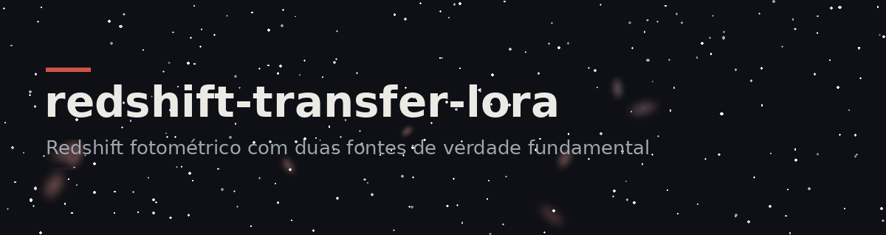
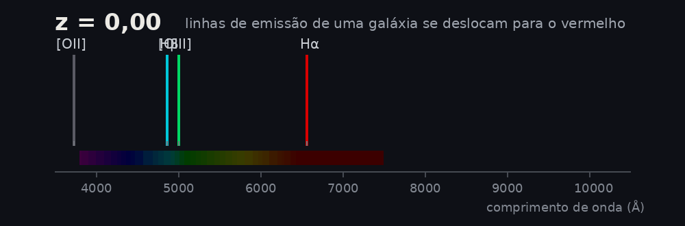
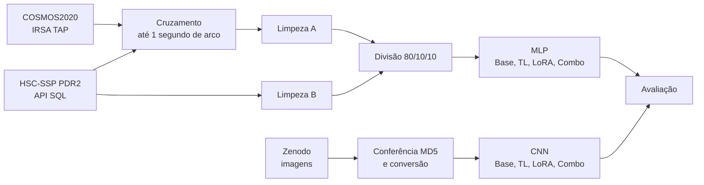

<p align="center">
  
</p>

<p align="center">
  
  
  
  
</p>

# redshift-transfer-lora

Estimativa de **redshift fotométrico** de galáxias usando duas fontes de verdade fundamental: um conjunto grande com redshift fotométrico do COSMOS2020 e um conjunto menor com redshift espectroscópico do HSC-SSP. O projeto compara quatro formas de treinar o modelo: **Base**, **TL** (aprendizado por transferência), **LoRA** (adaptação de baixo posto) e **Combo**.

Os dados tabulares foram coletados por raspagem dos servidores dos levantamentos, cruzados pela posição no céu e limpos com os critérios dos artigos de referência.

Trabalho final das disciplinas de **Ciência dos Dados** (Prof. Higor Alexandre Duarte Mascarenhas) e **Tópicos em Aprendizado de Máquina** (Prof. Michel Pires da Silva), Engenharia de Computação, UFCI-MG (Universidade Federal de Ciência e Inovação de Minas Gerais), Campus Divinópolis.

---

## Sumário

1. [O problema](#o-problema)
2. [Objetivos](#objetivos)
3. [Dados](#dados)
4. [Caminho dos dados](#caminho-dos-dados)
5. [Estrutura do repositório](#estrutura-do-repositório)
6. [Instalação](#instalação)
7. [Como reproduzir](#como-reproduzir)
8. [Resultados](#resultados)
9. [Limitações](#limitações)
10. [Referências](#referências)
11. [Autor](#autor)

---

## O problema

<p align="center">
  
</p>

O redshift indica a distância de uma galáxia. Quanto maior o redshift, mais as linhas do espectro da galáxia se deslocam para o vermelho, como mostra a animação acima.

| | Redshift espectroscópico | Redshift fotométrico |
|---|---|---|
| Como é obtido | Medido no espectro da galáxia | Estimado pelo brilho em 5 filtros de cor |
| Precisão | Alta | Até 100 vezes menor |
| Custo | Caro e lento | Barato e rápido |
| Alcance | Só galáxias brilhantes | Bilhões de galáxias |

Levantamentos como o LSST vão catalogar bilhões de galáxias, e só o redshift fotométrico é viável nessa escala. A pergunta deste trabalho é: **como treinar um modelo com um conjunto grande e impreciso e outro menor e preciso?**

| Estratégia | Como treina |
|---|---|
| Base | Só com o conjunto A (rótulo fotométrico) |
| TL | Parte do Base e ajusta algumas camadas com o conjunto B |
| LoRA | Parte do Base e treina só adaptadores pequenos com o B |
| Combo | Do zero, com A e B juntos |

## Objetivos

**Geral:** comparar as quatro estratégias de treino a partir de dados coletados por raspagem.

**Específicos:**

- Raspar o COSMOS2020 e o HSC-SSP por scripts, sem usar as interfaces manuais dos portais.
- Reconstruir os conjuntos TransferZ (A) e GalaxiesML (B) com os critérios dos artigos e comparar com os conjuntos publicados.
- Documentar cada critério de limpeza e cada decisão que os artigos não definiam.
- Medir viés, dispersão e custo de treino de cada estratégia.

## Dados

| Fonte | O que fornece | Como foi obtida | Volume baixado |
|---|---|---|---|
| [COSMOS2020](https://irsa.ipac.caltech.edu/) | Redshift fotométrico com até 35 filtros | Raspagem pelo serviço TAP do IRSA (`pyvo`) | 1.721.541 objetos (Classic) e 964.506 (Farmer) |
| [HSC-SSP PDR2](https://hsc-release.mtk.nao.ac.jp/) | Brilho em 5 filtros e redshift espectroscópico | Raspagem pela API de consultas SQL do HSC (`requests`) | 4.535.324 objetos no campo COSMOS e 801.246 com espectro |
| [Zenodo](https://zenodo.org/records/11117528) | Imagens de 5 filtros, 64×64 pixels | Download dos arquivos publicados pelos autores | 43,6 GB, 386.843 galáxias |

### Tipos de dados

| Tipo | Exemplos | Uso |
|---|---|---|
| Numérico | Brilho nos filtros, redshift, χ², posição no céu | Entrada, rótulo, filtros e cruzamento |
| Inteiro | Identificadores do HSC, da Classic e da Farmer | Ligar tabelas |
| Categórico | Tipo do objeto: galáxia, estrela ou outro | Filtro: só galáxias |
| Verdadeiro ou falso | Objeto primário, marcações de qualidade | Filtros |
| Texto | Nome do espectro | Remover repetições |
| Imagem | Matriz de 5×64×64 valores por galáxia | Entrada da CNN |

Nenhuma variável categórica entrou nos modelos. Elas serviram para filtrar e para remover repetições, então não foi preciso codificá-las.

### Conjuntos finais

| Conjunto | Reproduz | Galáxias | Diferença para o publicado | Redshift mediano |
|---|---|---|---|---|
| A | TransferZ | 113.646 | 2,3% abaixo (116.335) | 0,95 |
| B | GalaxiesML | 285.578 | 0,3% abaixo (286.401) | 0,49 |

Cada conjunto foi dividido em 80% treino, 10% validação e 10% teste (semente 42). As 266 galáxias presentes nos dois conjuntos saíram do A. O Combo é a união das divisões de A e B, então nenhuma galáxia de teste entra num treino.

<details>
<summary><b>Limpeza do conjunto A, critério por critério</b></summary>

| Critério | Restam |
|---|---|
| Pares do cruzamento (até 1 segundo de arco, um para um) | 691.871 |
| Classificado como galáxia | 670.181 |
| 23 filtros com brilho válido | 254.827 |
| Redshift nas 4 configurações (Classic e Farmer, LePhare e EAZY) | 248.369 |
| Qualidade do ajuste (χ²) aceitável | 192.093 |
| Estimativa principal e alternativa próximas | 174.609 |
| As 4 estimativas concordam | 115.142 |
| Redshift menor que 4 | 115.123 |
| Brilho válido nos 5 filtros do HSC | **113.646** |

Três critérios não eram definidos no artigo e foram decididos aqui: os 23 filtros são exigidos nas duas versões do catálogo; os limites de χ² das outras três configurações mantêm a mesma proporção de objetos (91,5%); e a margem de concordância é 0,1.

</details>

<details>
<summary><b>Limpeza do conjunto B, critério por critério</b></summary>

| Critério | Restam |
|---|---|
| Consulta com redshift espectroscópico | 801.246 |
| Redshift entre 0,01 e 4 | 767.038 |
| Erro do redshift pequeno | 751.187 |
| Brilho válido nos 5 filtros | 751.107 |
| Sem repetição pelo nome do espectro | 342.402 |
| Sem repetição pelo identificador do HSC | 339.654 |
| Marcação de qualidade homogênea | **285.578** |

</details>

## Caminho dos dados



## Estrutura do repositório

```
redshift-transfer-lora/
├── assets/                  GIFs deste README
├── data/
│   ├── raw/                 dados raspados e imagens (fora do Git)
│   ├── interim/             resultado do cruzamento
│   └── processed/           conjuntos limpos
├── src/
│   ├── collection/          cosmos2020.py, hsc.py e consultas .sql
│   ├── preprocessing/       cruzamento_a.py, limpeza_a.py, limpeza_b.py,
│   │                        preparar_dados.py, preparar_imagens.py
│   ├── training/            treinar.py (MLP), treinar_cnn.py (CNN)
│   └── evaluation/          avaliar.py, avaliar_cnn.py, incerteza_mlp.py,
│                            incerteza_cnn.py, analise_faixas.py
├── results/                 métricas, tabelas e figuras
└── requirements.txt
```

Os dados brutos e os modelos treinados ficam fora do Git, porque somam dezenas de gigabytes. Os scripts baixam os dados de novo.

| Etapa | Bibliotecas |
|---|---|
| Extração | `pyvo`, `requests` |
| Tratamento | `pandas`, `numpy`, `astropy` |
| Imagens | `h5py`, `numpy` |
| Modelos | `torch`, `torchvision`, `peft` |
| Visualização | `matplotlib`, `scipy` |

## Instalação

```bash
git clone https://github.com/Matheus-Emanue123/redshift-transfer-lora.git
cd redshift-transfer-lora
pip install -r requirements.txt
```

Para treinar na GPU, instale o PyTorch com suporte a CUDA pelo comando que o site [pytorch.org](https://pytorch.org/get-started/locally/) indica para a sua placa. Os treinos deste trabalho rodaram numa NVIDIA RTX 3050 Laptop de 4 GB.

O acesso ao HSC-SSP exige um cadastro gratuito no [arquivo do HSC](https://hsc-release.mtk.nao.ac.jp/). O usuário e a senha ficam em variáveis de ambiente, nunca no código.

## Como reproduzir

Todos os comandos rodam na raiz do repositório. Os exemplos usam PowerShell; no Linux, troque `$env:NOME = "valor"` por `export NOME="valor"`.

### 1. Raspagem

```powershell
# COSMOS2020 (sem cadastro). Baixa em faixas e retoma de onde parou.
python src/collection/cosmos2020.py classic
python src/collection/cosmos2020.py farmer

# HSC-SSP (com cadastro)
$env:HSC_SSP_CAS_USER = "seu_usuario"
$env:HSC_SSP_CAS_PASSWORD = "sua_senha"
python src/collection/hsc.py --sql src/collection/conjunto_a_wide.sql --saida data/raw/hsc_pdr2_wide_cosmos.csv.gz
python src/collection/hsc.py --sql src/collection/conjunto_b.sql --saida data/raw/hsc_pdr2_wide_specz.csv.gz
```

Use `--preview` para testar uma consulta com só 10 linhas antes da coleta completa.

### 2. Cruzamento, limpeza e divisão

```powershell
python src/preprocessing/cruzamento_a.py
python src/preprocessing/limpeza_a.py
python src/preprocessing/limpeza_b.py
python src/preprocessing/preparar_dados.py
```

### 3. MLP

```powershell
# Base e as três estratégias com 100% do B, para as 3 sementes
foreach ($s in 0,1,2) {
  python src/training/treinar.py base --semente $s
  foreach ($e in "tl","lora","combo") { python src/training/treinar.py $e --semente $s }
}

# Frações do B (10%, 25% e 50%)
foreach ($s in 0,1,2) { foreach ($f in 10,25,50) { foreach ($e in "tl","lora","combo") {
  python src/training/treinar.py $e --fracao $f --semente $s
} } }

# Direção inversa: Base no B, ajuste no A
foreach ($s in 0,1,2) { foreach ($e in "base","tl","lora") { python src/training/treinar.py $e --inverso --semente $s } }
```

### 4. CNN com imagens

Baixe os arquivos de 64×64 pixels do [GalaxiesML](https://zenodo.org/records/11117528) para `data/raw/imagens/galaxiesml/` e do [TransferZ-Images](https://zenodo.org/records/16989604) para `data/raw/imagens/transferz/`. Confira o MD5 de cada arquivo com o valor do Zenodo:

```powershell
Get-FileHash -Algorithm MD5 data\raw\imagens\transferz\*.h5, data\raw\imagens\galaxiesml\*.hdf5
```

```powershell
python src/preprocessing/preparar_imagens.py
python src/training/treinar_cnn.py base
python src/training/treinar_cnn.py tl --max_epocas 100
python src/training/treinar_cnn.py lora --max_epocas 100
python src/training/treinar_cnn.py combo
```

### 5. Avaliação

Os scripts de avaliação importam a arquitetura dos scripts de treino, então a pasta `src/training` precisa estar no caminho do Python:

```powershell
$env:PYTHONPATH = "src/training"
python src/evaluation/avaliar.py
python src/evaluation/avaliar_cnn.py
python src/evaluation/incerteza_mlp.py
python src/evaluation/incerteza_cnn.py
python src/evaluation/analise_faixas.py
```

## Resultados

Métricas na faixa 0,3 < z < 1,5. **Viés** é a mediana de Δz = (z previsto − z real)/(1 + z real); **dispersão** é 1,4826 vezes o desvio absoluto mediano de Δz. Os limites do LSST são |viés| < 0,003 e dispersão < 0,02.

### MLP, teste B (média de 3 sementes)

| Estratégia | Dispersão, 100% do B | Dispersão, 10% do B | Parâmetros treinados | Minutos |
|---|---|---|---|---|
| Base | 0,0340 | não usa o B | 4.537.801 | 1,2 |
| TL | 0,0232 | 0,0259 | 413.200 | 14,5 |
| LoRA | 0,0232 | **0,0246** | 38.444 | 4,9 |
| Combo | 0,0233 | 0,0267 | 4.537.801 | 7,0 |

Usar o conjunto B reduz a dispersão em 1,5 vez. Com todos os dados, TL, LoRA e Combo ficam iguais; com 10% do B, a LoRA é a melhor e treina menos de 1% dos parâmetros.

### CNN, teste do GalaxiesML

| Estratégia | Viés | Dispersão | Minutos | Limites do LSST |
|---|---|---|---|---|
| Base | −0,0066 | 0,0495 | 7,9 | não atende |
| TL | −0,0022 | 0,0255 | 130,8 | não atende |
| LoRA | −0,0004 | 0,0196 | 152,7 | **atende** |
| Combo | −0,0017 | 0,0157 | 233,9 | **atende** |

Combo e LoRA ficaram muito perto dos valores publicados pelos autores da CNN. A LoRA treinou 1,5 vez mais rápido que o Combo.

### O que os dados explicaram

- **A composição do teste muda a conclusão.** Na MLP, ajustar de B para A ou de A para B deu o mesmo erro que treinar só no conjunto de destino. A ordem só parece importar no teste misto, porque 2 de cada 3 galáxias dele vêm do B.
- **Faltam galáxias distantes no B.** Só 2,1% do treino do B está entre redshift 1,5 e 2, contra 11,2% no A. Modelos que começam no B erram de 7% a 14% mais entre 1,5 e 3.
- **Incerteza.** O desvio entre 3 sementes (MLP) e o MC dropout (CNN) indicam quais galáxias são mais confiáveis, mas subestimam o erro: só 12% a 41% das galáxias ficam dentro de 1 sigma.

## Limitações

- Os dados vêm de um único campo do céu (COSMOS).
- Galáxias com espectro são mais brilhantes e mais próximas que a média.
- As imagens são as publicadas pelos autores, não foram raspadas: um piloto indicou cerca de 38 horas de download só para o conjunto A.
- A CNN foi treinada uma vez só, com limite de 100 épocas.

## Referências

- Soriano et al. *TransferZ*, transferência entre redshift fotométrico e espectroscópico. [arXiv:2411.18054](https://arxiv.org/abs/2411.18054)
- Seenivasan et al. LoRA para redshift fotométrico com imagens. [arXiv:2601.00146](https://arxiv.org/abs/2601.00146), [código](https://github.com/astrodatalab/seenivasan_2025)
- Do et al. *GalaxiesML*. [arXiv:2410.00271](https://arxiv.org/abs/2410.00271)
- Weaver et al. (2022). *COSMOS2020*. ApJS 258, 11.
- Aihara et al. (2019). *Second Data Release of the Hyper Suprime-Cam Subaru Strategic Program*. PASJ 71, 114.
- Hu et al. (2021). *LoRA: Low-Rank Adaptation of Large Language Models*. [arXiv:2106.09685](https://arxiv.org/abs/2106.09685)

## Autor

**Matheus Emanuel da Silva**, Engenharia de Computação, UFCI-MG, Campus Divinópolis.
matheus.emanuel@aluno.cefetmg.br

<p align="center"><sub>As animações deste README foram geradas em Python para este projeto.</sub></p>